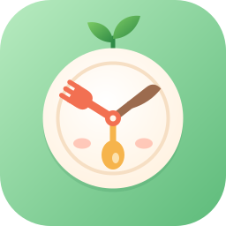
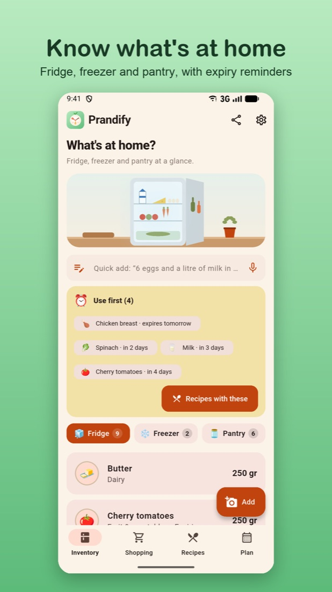
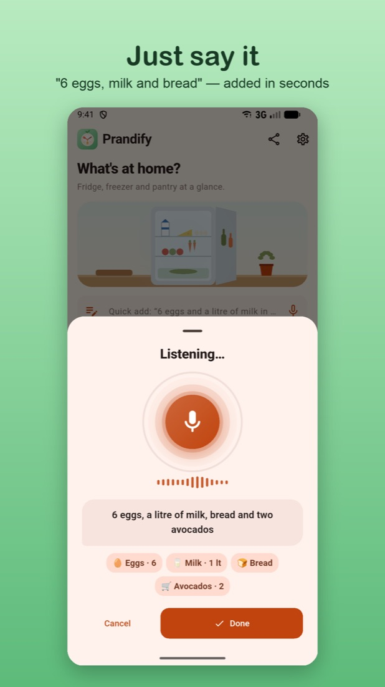
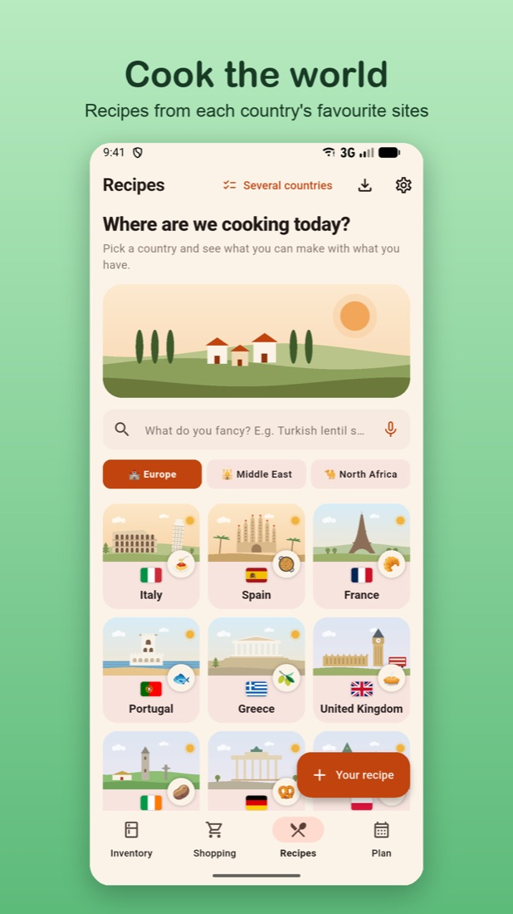
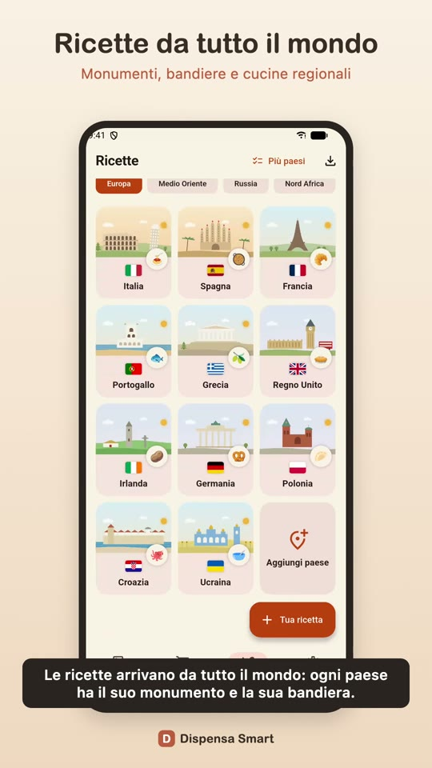
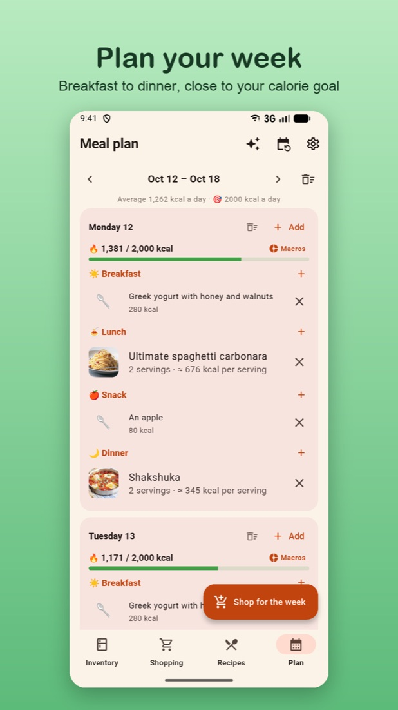
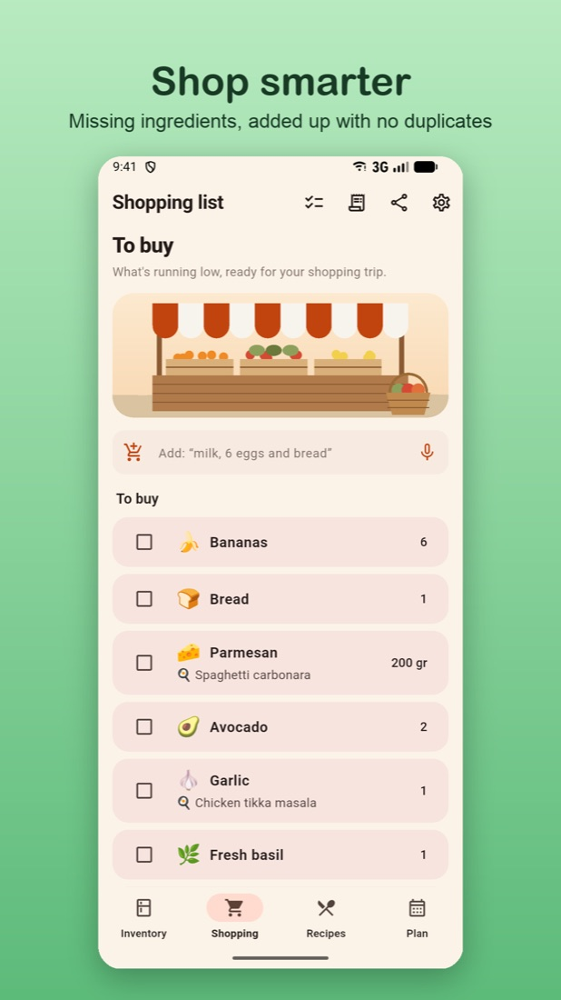

<h1 align="center">Prandify</h1>

<a href="https://prandify.com">prandify.com</a>

**Less waste, better recipes.** A Flutter app that brings your pantry, shopping list and recipes from around the world into one place. It works offline, the AI runs on the phone, and it's available in 21 languages.

> 🇮🇹 *Prandify (dal latino* prandium, *"pasto"): dispensa, lista della spesa e ricette da tutto il mondo, con l'AI che gira sul telefono. Funziona offline, in 21 lingue.*

  
  
  
  
  
  

▶️ <a href="media/demo.mp4"><b>Watch the 90-second demo</b></a>

---

## ✨ Features

- **Pantry & expiry dates**: add products by barcode (Open Food Facts), photo, text or voice. It understands quantities and units, and sends a reminder the day before a product expires.
- **Receipt reader**: on-device OCR. Each item and its quantity goes straight into the pantry.
- **Smart shopping list**: works with mixed languages, uses product emojis and can be shared. It shows this month's spending from your receipts, and a 🏷️ button on each product opens local supermarket offers (optional, with your city).
- **Recipes from social media**: share an Instagram, TikTok or YouTube post with the app. It extracts the ingredients and steps, detects the language and the country of the dish, and keeps the video attached.
- **World & regional cuisines**: hand-drawn landmark scenes for each country. Recipes come from each country's reference sites through schema.org data.
  - You can search a dish or an ingredient in any language, and filter by type or region.
  - Results load as you scroll, page after page of the site's results.
- **Original or translated**: when the phone has on-device AI, recipes are translated by the AI. The steps stream in as they are written, and translations are cached. Otherwise a basic translation is used, with Google Translate one tap away. You can switch to the original with one tap, and copy or edit the text.
- **Allergens**: covers the 14 EU allergens plus vegetarian and vegan. Recipes are checked against your profile, in multiple languages.
- **"Suggest a dish"**: tell it what you fancy, in any language or a mix ("patate, köfte"), pick the countries, and it searches their recipe sites for you. Results appear inside the app, without opening the site. It ranks the dishes by:
  - the calories left for that meal;
  - preparation time, with a "quick" filter (≤ 30 min);
  - your allergies;
  - what's already in your pantry, with products about to expire first.
- **Calories & meal plan**: a weekly plan split into breakfast, lunch, snack and dinner. Each day is checked against a personal kcal goal (Mifflin-St Jeor), and menus can be saved and repeated for months.
- **Your household**: set how many people you usually cook for, and every recipe and meal plan scales to it.
- **Shared pantry** between household members (Firebase), a home-screen widget, and backup and restore.
- **Transparent by design**: privacy, health disclaimers and data credits (Open Food Facts, ODbL) are always readable inside the app.

## 🛠 Tech stack

| Area | Technologies |
|---|---|
| App | Flutter / Dart, Provider, Material 3, custom-painted illustrations |
| Storage | SQLite (sqflite) with versioned migrations, offline-first |
| Cloud | Firebase (Firestore, rules, anonymous auth) for shared pantries; RevenueCat for subscriptions |
| On-device AI | Gemini Nano (Android), Apple Foundation Models (iOS), Gemma via LiteRT (optional) |
| Vision & language | Google ML Kit: text recognition, language ID, translation; barcode scanning |
| Platform | Android share intents, iOS Share Extension, home-screen widgets, scheduled notifications |
| i18n | 21 languages (gen-l10n + an automated DeepL pipeline) |

## 🧠 Engineering highlights

- **Recipe parsing from free text**: social media captions are messy. A heuristic parser recognises section headers ("Per la crema:"), inline lists, quantities in many languages, and the point where the ingredients end and the steps begin.
- **Works with sites it has never seen**: it finds each site's search on its own. It tries the OpenSearch description, then the site's search form (also inside a headless WebView for JavaScript-built pages), then the WordPress default. It also detects result pagination (`rel="next"`, numbered page links).
- **Cross-language recipe search**: the query is split into food terms and matched against a multilingual food dictionary. Unknown words fall back to on-device translation. One search becomes "patates" on a Turkish site and "potatoes" on an English one.
- **Calorie estimation without a server**: an offline nutrition table, unit-to-gram conversion across languages and typical piece weights. Each estimate comes with a confidence score.
- **Privacy by design**: the AI, OCR and translation all run on the device. There are no ads and no tracking.

## 📱 Status

The Android app is in active development, and iOS support is in progress. A premium tier (RevenueCat) is being built on top of a generous free version, with no ads. It will include an automatic weekly diet, price history and macros. Store release is coming soon.

---

🔒 *The source code is private. It is available on request for recruiters and collaborators.*
